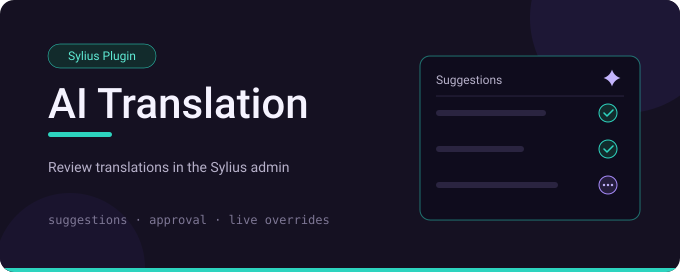
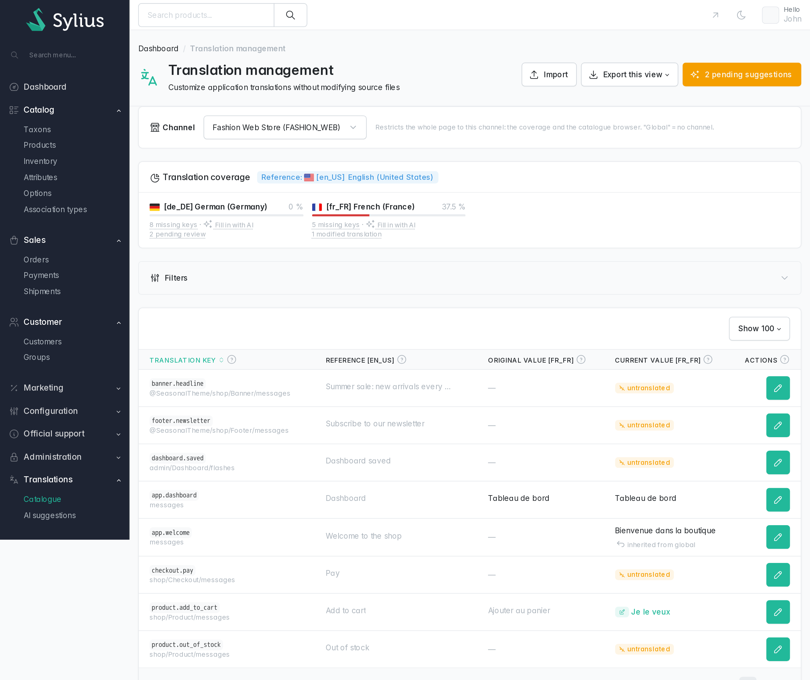
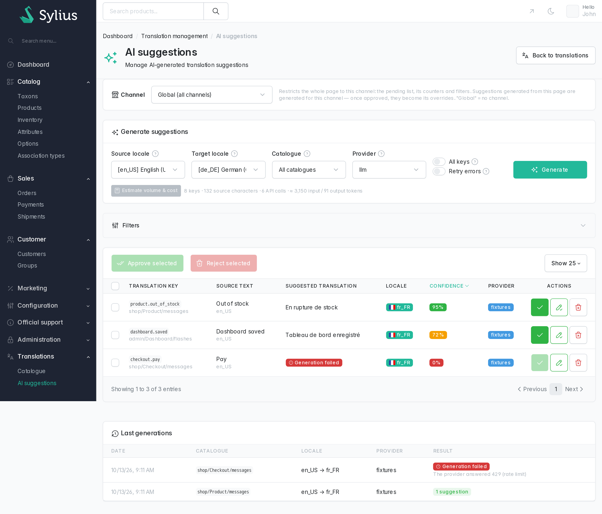
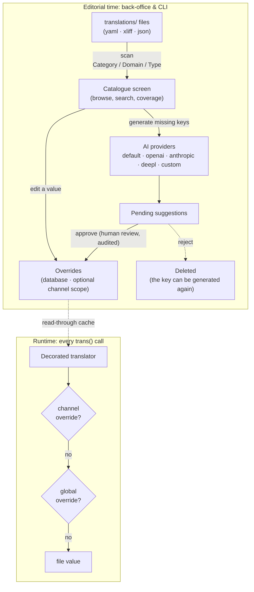

# Sylius AI Translation Plugin

[](LICENSE)
[](https://packagist.org/packages/cyllene-digital/sylius-ai-translation-plugin)
[](https://github.com/CylleneDigital/SyliusAiTranslationPlugin/actions/workflows/build.yaml)
[](https://github.com/CylleneDigital/SyliusAiTranslationPlugin/actions/workflows/security.yaml)

Back-office integration of the **[AI translation engine](https://github.com/CylleneDigital/AiTranslationBundle)**
for **Sylius 2**: browse the project's translation catalogues, override any wording at runtime
(per sales channel if needed), and let AI providers suggest the missing translations, with a
per-channel context for the AI, under human review, always.

<table>
  <tr>
    <td width="50%" align="center" valign="top">
      <a href="docs/assets/admin-translations.png"></a>
      <br><sub><b>Translation management</b>: channel selector, coverage per locale, catalogue browsing, overrides of the channel or inherited from the global ones</sub>
    </td>
    <td width="50%" align="center" valign="top">
      <a href="docs/assets/admin-suggestions.png"></a>
      <br><sub><b>AI suggestions</b>: generation with a volume estimate, human review of the pending suggestions, journal of the last runs</sub>
    </td>
  </tr>
</table>

## Compatibility

| Component | Versions |
|---|---|
| PHP | `^8.3` (Symfony 8: `^8.4`) |
| Sylius | `2.1`, `2.2`, `2.3` |
| Symfony | `^7.4`, or `^8.0` with Sylius 2.3 |
| [`cyllene-digital/ai-translation-bundle`](https://packagist.org/packages/cyllene-digital/ai-translation-bundle) | `^1.4.1` |

In a Symfony 7.4 project, pin the stack with `extra.symfony.require: "7.4.*"` (standard Flex
practice): without it Composer may mix Symfony 8 components (`symfony/var-exporter`…) into a
7.4 framework, which breaks Doctrine proxy generation at boot.

## What this plugin does

Two admin screens plugged into the standard Sylius layout (menu, twig hooks, admin firewall):

- **Catalogue**: browse the host project's `translations/` by Category / Domain / Type,
  per-locale coverage cards linking straight to generation, edition of any value in a modal (the
  override is stored in database), per-channel overrides with global fallback, cross-catalogue
  search and "modified only" view, view-snapshot export/import in XLIFF or CSV (originals
  included, re-import only keeps the changes), one-click purge of orphan overrides;
- **AI suggestions**: per-catalogue generation with a volume/cost estimate before spending
  anything, review of pending suggestions (single or bulk approve/reject, the value editable
  before approval, confidence/provider/placeholder badges), a failed generation staying in the list, flagged,
  so it can be retried or written by hand, and the last runs of the channel, failures included;
- **Themes**: every `themes/*/translations` directory is auto-discovered and browsed as
  `@ThemeName/…` catalogues, with the same precedence as the theme files at runtime;
- **Sylius adapters**: locales come from *Configuration → Locales*, and the logged-in admin
  signs every override and every review decision.



Two properties matter more than the rest:

**No file is ever written.** Overrides are database deltas applied over the compiled
catalogues: they survive redeployments and immutable containers, the original value is always
one click away, and removing an override restores the inherited or file value instantly. A
regional locale inherits its language's overrides too (`fr_FR` falls back on `fr`), and the
screens say where an inherited value comes from.

**Nothing AI-generated is applied without a human.** Generation produces *pending* suggestions;
only an explicit approval turns one into an override, kept with who approved it and when; a
rejected suggestion is deleted. A placeholder guard blocks approvals that would break ICU/`%name%` parameters.

## What this plugin does not do

- **It is not the engine.** Providers, overrides, caches, console commands and the configuration
  tree live in [`cyllene-digital/ai-translation-bundle`](https://github.com/CylleneDigital/AiTranslationBundle),
  which also works without Sylius.
- **It does not translate entity content.** Product names and descriptions are Sylius translation
  data with its own tooling: the scope stops at the project's message catalogues.
- **It never writes a translation file**, and applies nothing an AI generated without an explicit
  approval.
- **It has no API and no shop screen**: both screens are in the back office, and the shop only
  shows the result.

## Installation

```bash
composer config extra.symfony.allow-contrib true
composer require cyllene-digital/sylius-ai-translation-plugin   # installs the engine too
```

With Symfony Flex, the recipes do steps 1 and 2 and copy a commented
`config/packages/cyllene_digital_ai_translation.yaml`: go to step 3. Without Flex, follow every
step.

1. Register the engine, then the plugin **after** it:

```php
// config/bundles.php
CylleneDigital\AiTranslationBundle\CylleneDigitalAiTranslationBundle::class => ['all' => true],
CylleneDigital\SyliusAiTranslationPlugin\CylleneDigitalSyliusAiTranslationPlugin::class => ['all' => true],
```

2. Import the admin routes:

```yaml
# config/routes/cyllene_digital_sylius_ai_translation.yaml
cyllene_digital_sylius_ai_translation:
    resource: '@CylleneDigitalSyliusAiTranslationPlugin/config/routes.yaml'
```

3. Configure the engine under its `cyllene_digital_ai_translation` key (providers,
   `translations_path`, `default_locale`, `llm_context`…) - in the file the recipe copied, or
   one you create without Flex.

4. Version the engine tables in **your** migrations: the engine ships its Doctrine mapping,
   not migrations (re-run the diff after updating it, too):

```bash
bin/console doctrine:migrations:diff && bin/console doctrine:migrations:migrate
```

5. Import the plugin's admin entrypoint from yours, then build your assets. It carries the
   stylesheet and the Stimulus controllers of both screens: without it they render unstyled and
   the modals, the cost estimate and the channel selector stay inert.

```js
// assets/admin/entrypoint.js
import '../../vendor/cyllene-digital/sylius-ai-translation-plugin/assets/admin/entrypoint.js';
```

```bash
yarn install
yarn build
```

6. Grant the roles the screens require: without one they answer 403 and the menu entry is not
   shown. Everything to every admin, or one role per kind of action
   ([permissions](https://github.com/CylleneDigital/SyliusAiTranslationPlugin/blob/main/docs/integration/permissions.md)):

```yaml
# config/packages/security.yaml
security:
    role_hierarchy:
        ROLE_ADMINISTRATION_ACCESS: [ROLE_AI_TRANSLATION_MANAGE]
```

Every step in detail, with and without Flex: [installation](https://github.com/CylleneDigital/SyliusAiTranslationPlugin/blob/main/docs/integration/installation.md).


## In production

Generation runs asynchronously on the engine's own Messenger transport: keep a worker on
`bin/console messenger:consume cyllene_ai_translation`. The plugin dispatches the runs on its
own bus (`cyllene_digital_ai_translation.bus`), not on `sylius.command_bus`: that one wraps
handlers in `doctrine_transaction`, and a failing chunk would roll back the suggestions already
billed. Dispatch `GenerateSuggestionsMessage` yourself? Use that bus too.

A generation sent twice is queued twice, and bills a key once as long as its suggestion waits for
a review: the engine runs one generation at a time per catalogue, target locale and channel, and
skips every key that already has a pending suggestion. That guard is a `symfony/lock` lock, whose
default store is local to one machine: workers spread over several hosts need a shared store
(`framework.lock`). When the store cannot be reached, the engine logs a warning and runs the
generation unguarded: two concurrent runs are then billed twice. A key is billed again in two
cases: its suggestion was reviewed in between and the run still covers it (a rejected one, or any
key of an "All keys" run), or the run is a "Retry errors" one, which re-sends the keys whose
previous run failed for as long as they fail. A run for a channel deleted since it was queued
bills nothing: the engine refuses it before calling the provider. A run whose channel is deleted
while it runs stops before its next chunk, journaled as a failure: only the chunk already with
the provider is billed.

The engine keeps the translation files it parses in the
`cyllene_digital_ai_translation.translation_files_cache` pool, keyed by their content: a file
rewritten in place is read again at once. After an upgrade of `symfony/translation`, the files
already parsed stay as they were until they expire (seven days): empty the pool with
`bin/console cache:pool:clear cyllene_digital_ai_translation.translation_files_cache`.
`cache:clear` does not when `APP_SHARE_DIR` is set (the Symfony 7.4 and 8 skeletons).

An uploaded import waits for its confirmation, one hour at most, in the
`cyllene_digital_sylius_ai_translation.import_staging` cache pool, built on `cache.app`. Behind a load
balancer, the confirmation only finds the upload if that cache is shared between the nodes
(Redis…), or point the pool itself at a shared adapter:

```yaml
# config/packages/cache.yaml
framework:
    cache:
        pools:
            cyllene_digital_sylius_ai_translation.import_staging:
                adapter: cache.adapter.redis
```

## Troubleshooting

| Symptom | Cause |
|---|---|
| Both screens render unstyled, the modals and the cost estimate do nothing | The admin entrypoint is not imported, or the assets were not rebuilt ([assets](https://github.com/CylleneDigital/SyliusAiTranslationPlugin/blob/main/docs/integration/assets.md)) |
| The screens answer 403, or the **Translations** menu entry is missing | No role of the plugin is granted ([permissions](https://github.com/CylleneDigital/SyliusAiTranslationPlugin/blob/main/docs/integration/permissions.md)) |
| A generation is queued and no suggestion arrives | No worker consumes `cyllene_ai_translation`; a run that failed shows in the journal under the list |
| `Cannot reorder children, order does not contain all children.` | The project reorders its admin menu with a fixed list ([menu](https://github.com/CylleneDigital/SyliusAiTranslationPlugin/blob/main/docs/integration/theming.md#menu)) |
| An import file is refused for its size although it is under 8 MB | PHP accepts less (`upload_max_filesize`, `post_max_size`): the import window announces the limit that really applies |
| An import is refused as expired right after the upload | The upload and its confirmation were served by two nodes that do not share `cache.app` (see [In production](#in-production)) |

## Upgrading

Every compatibility break is written in [UPGRADE.md](UPGRADE.md) before it is released, with the
steps to carry out. The engine has its own
[upgrade guide](https://github.com/CylleneDigital/AiTranslationBundle/blob/main/UPGRADE.md).

## Public contract

The bundle class, the admin routes, the Twig hooks and templates, the grids, the roles, the menu
entry and the generation bus only change in a major version. The full list, what is internal and
the support policy: [public contract](https://github.com/CylleneDigital/SyliusAiTranslationPlugin/blob/main/docs/architecture/public-contract.md).

## Documentation

- [Back-office guide](https://github.com/CylleneDigital/SyliusAiTranslationPlugin/blob/main/docs/admin/user-guide.md): both screens in detail, for administrators
- [Theming and Twig hooks](https://github.com/CylleneDigital/SyliusAiTranslationPlugin/blob/main/docs/integration/theming.md): templates, Twig hooks, grids, the menu entry, for integrators
- [Technical documentation](https://github.com/CylleneDigital/SyliusAiTranslationPlugin/blob/main/docs/README.md): every page, by audience
- [Decision records](https://github.com/CylleneDigital/SyliusAiTranslationPlugin/blob/main/docs/adr/README.md): why the plugin is built the way it is, one decision per file
- [Engine documentation](https://github.com/CylleneDigital/AiTranslationBundle/tree/main/docs): concepts, provider bridges, configuration reference, CLI, caches

## Status

**Exercised on a real Sylius 2.3 back office**: the functional tests boot the plugin inside the
Sylius test application against a real database, log an admin in and drive both screens through
the HTTP kernel, the suggestion workflow included.

**The continuous integration matrix** runs the unit, integration and functional tests, 45 Behat scenarios
(13 of them in headless Chrome, on the primary combination; 12 reading the result in the shop), PHPStan at `max` level, the coding
standard, container, template and translation linting and a strict `composer validate` on PHP
8.3, 8.4 and 8.5, against Sylius 2.1, 2.2 and 2.3 on MySQL 8.4 - and, on the primary
combination, on MySQL 8.0, MariaDB 10.11 and 11.4, PostgreSQL 15, 16 and 17.

Both screens are driven by a
**channel filter**: coverage, counters, browsing, suggestion generation and review all
happen for the selected channel (or globally).

## Contributing

[`CONTRIBUTING.md`](CONTRIBUTING.md) - setting up the test environment, standards, what has to pass.

A flaw is reported privately: [`SECURITY.md`](SECURITY.md). Do not open it as a public issue.

## Provenance and licence

Released under the **MIT** licence: see [`LICENSE`](LICENSE).

---

Package: [`cyllene-digital/sylius-ai-translation-plugin`](https://packagist.org/packages/cyllene-digital/sylius-ai-translation-plugin)

Maintained by [Cyllene](https://www.groupe-cyllene.com), on GitHub as
[@CylleneDigital](https://github.com/CylleneDigital)
